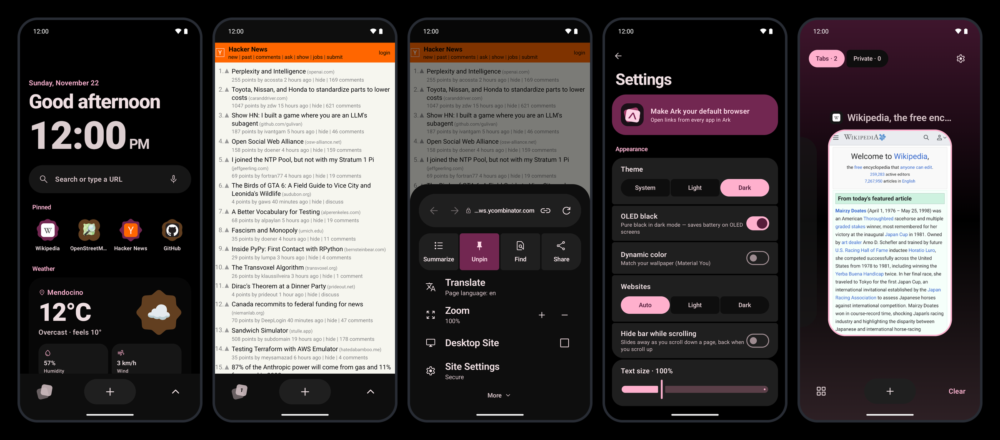

<div align="center">


# Ark

**A fast, private Android browser with the Arc mobile layout — on Firefox's engine, in Material 3 Expressive.**
No ads, no tracking, no account. Everything the web asks for actually works.

<a href="https://github.com/visiuun/ark-browser/releases/latest/download/Ark.apk">
  
</a>

<br><br>


</div>

<br>



## At a glance

```text
Problem    Arc Search on Android has the nicest layout of any mobile browser — and it's broken.
           It supports almost nothing: no location, no file uploads, no extensions, no downloads
           worth the name. The one browser that feels right doesn't actually work.

Ark        The same layout, rebuilt on Mozilla's GeckoView — the real Firefox engine. The menu,
           the tab bar and the new-tab sheet match Arc's shape and gestures, but location, camera,
           microphone, downloads, notifications, file pickers, PWAs and Firefox add-ons all work.
           Material 3 Expressive throughout, with a true-black OLED mode.

Setup      Install Ark.apk and open it. Optionally set it as your default browser from Settings.
           That's it — no account, no setup, no Google Play Services.
```

## The layout

The chrome is deliberately identical to Arc Search: a three-button bottom bar (tabs · new tab · menu), the same rounded menu sheet that slides up with a URL pill and a row of big action tiles, and the same full-screen new-tab search with pinned sites. The difference is underneath — it's a full browser.

- **Bottom bar** — tap for tabs, new tab and the menu. Swipe up for the menu, swipe left/right to flick between tabs, long-press for a private tab. Optionally slides out of the way while you scroll down a page and comes back when you scroll up (Settings › Appearance).
- **Menu sheet** — Summarize · Pin · Find · Share across the top, then Translate, Zoom, Desktop Site and Site Settings. Scroll down (or tap **More**) for History, Downloads, Add-ons, Settings, Private, Home screen, PDF and Print.
- **Tab switcher** — a swipeable card deck with live page previews, plus a grid view and a separate private space.

## Everything works

Because Ark runs on GeckoView, the things Arc can't do are just... there:

| | |
|---|---|
| **Location** | Real GPS and network location, with a proper Android permission prompt |
| **Camera & mic** | `getUserMedia` for calls, QR scanners and voice |
| **Downloads** | Progress notifications, saved to your Downloads folder, with a manager |
| **File uploads** | File picker and direct camera capture for `<input type=file>` |
| **Firefox add-ons** | Install any extension from addons.mozilla.org — uBlock, Dark Reader, Bitwarden… |
| **Notifications** | Web push and the Web Notifications API as real Android notifications |
| **PWAs** | Add any site to your home screen as a standalone shortcut |
| **The rest** | WebAuthn/passkeys, autofill, fullscreen video, picture-in-picture, print, share |

## Built-in ad blocker

[uBlock Origin](https://github.com/gorhill/uBlock) ships inside the app and turns itself on the first time you launch. It blocks ads, trackers, malware domains and annoyances out of the box, works in private tabs, and keeps its filter lists up to date. Turn it off or open its dashboard from **Settings › Ad blocker**.

## Reader tools

- **Summarize** — a real AI summary of any article: a one-line TL;DR, the key points with the names, numbers and dates that matter, and topics. It uses [Pollinations](https://pollinations.ai) (free, open source, no account) and only after you say yes; private tabs never use it. Prefer to keep everything local? Turn it off and Ark picks the key sentences on your device instead.
- **Translate** — full-page translation using Firefox's on-device translation engine. The page never leaves your phone; language models download once.
- **Find in page**, per-site **zoom** that's remembered, and a clean **Reader-style** error page.

## A home worth opening

The new-tab screen is a small dashboard built only from free, open, key-less APIs:

- **Weather** from [Open-Meteo](https://open-meteo.com) — current conditions, 12-hour and 6-day forecast, from your location or a city you set.
- **Wikipedia** featured article, in the news, on this day and most-read.
- **Hacker News** top stories.
- Your **pinned sites** and **recent history**.

No account, no API key, no tracking. Place names use [OpenStreetMap Nominatim](https://nominatim.org); search suggestions come from DuckDuckGo and are never sent in private tabs.

Prefer Arc's empty new tab? **Settings › Home › Homepage** switches between this dashboard, **Blank** (just the Ark logo, which you can grab, throw and spin, with haptics, like Arc's. Once it's loose, shake your phone to rattle it around; double-tap it to pin it back) or **any page** you like.

## Material 3 Expressive

The whole UI is built on Google's Material 3 Expressive — connected button groups, spring motion, expressive shapes, wavy progress. It follows your wallpaper colours (Material You) on Android 12+, with light, dark, system and a dedicated **OLED true-black** theme.

## Updates

Ark checks GitHub releases once a day. When a new version is out you get a notification (if you allow it) and an **Update available** card on the home screen and in Settings. Tap **Update now**: it downloads the APK built for your phone's CPU and hands it to Android's installer — your tabs, pins and settings stay. Turn this off under **Settings › Updates**.

## Forget everything, lock everything

- **Forget everything when closed** (Settings › Forget & lock): like DuckDuckGo, every start is a blank slate. Close Ark and it erases your tabs, history, cookies, site data, caches and permissions, so it's private browsing all the time. Ark warns you before turning it on and lets you keep the sites you're signed in to.
- **Fireproofing**: right after you sign in to a site, Ark asks whether to fireproof it: **Fireproof**, **Not now** or **Don't ask again**. Fireproofed sites keep their cookies and stay signed in; everything else goes. Manage them in Settings or from a site's info sheet.
- **App lock**: open Ark with your fingerprint, face or screen lock. Ark locks when you leave it, and on Android 13+ its preview in Recents is hidden.

## Privacy

- No analytics, no telemetry, no account, no Google Play Services.
- Once a day Ark asks GitHub whether a newer release exists (it sends only the app version). You can turn this off.
- Enhanced Tracking Protection, HTTPS-only mode, Global Privacy Control and optional encrypted DNS (DNS over HTTPS: Cloudflare, Quad9, Mullvad, AdGuard, NextDNS or any resolver URL you enter) are all built in.
- Private tabs keep no history, cookies or cache.
- Websites see Firefox's normal user agent with `Ark/<version>` added at the end (like Edge adds `Edg/`). Turn it off in **Settings › Advanced** if a site misbehaves.

## Compatibility

Android 8.0 (API 26) and up. The `Ark.apk` release targets **arm64** (every modern phone); an **x86_64** build is provided for emulators.

## Build

```bash
git clone https://github.com/visiuun/ark-browser
cd ark-browser
./gradlew assembleArm64Release
# APK in app/build/outputs/apk/arm64/release/
```

Requires JDK 17 and the Android SDK (compileSdk 37). A shared signing key is included so release builds install over each other.

## Credits

- [Mozilla GeckoView](https://mozilla.github.io/geckoview/) — the Firefox web engine (MPL 2.0)
- [uBlock Origin](https://github.com/gorhill/uBlock) by Raymond Hill — bundled ad blocker (GPL 3.0)
- [Material Symbols](https://fonts.google.com/icons) — icons (Apache 2.0)
- Data: Open-Meteo, OpenStreetMap, Wikipedia, Hacker News

## License

Ark is **free for noncommercial use, and credit is mandatory**: [PolyForm Noncommercial 1.0.0](https://polyformproject.org/licenses/noncommercial/1.0.0) plus the Ark Additional Terms, both in [LICENSE](LICENSE).

- **You can** use Ark as your browser (at home or at work), read and modify the code, share it for free, and fork it under your own name. Schools, charities, research and reviews are all fine.
- **You must** credit "Based on Ark by visiuun" with a link to this repo, both inside your app and wherever you offer it, and keep the license with every copy.
- **You can't**, without written permission: sell it, add ads or paid placements, monetize user data, ship it in a for-profit product, or pass a fork off as Ark.

Releases before 1.5.0 were published under CC BY-NC 4.0. Bundled components (GeckoView, uBlock Origin, Material Symbols) keep their own licenses, listed in [LICENSE](LICENSE).

Not affiliated with The Browser Company or Arc. "Arc" is referenced only to describe the layout this app reproduces.
